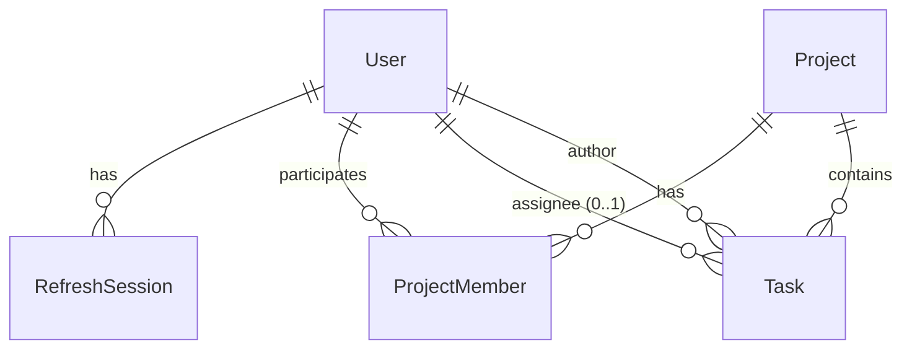
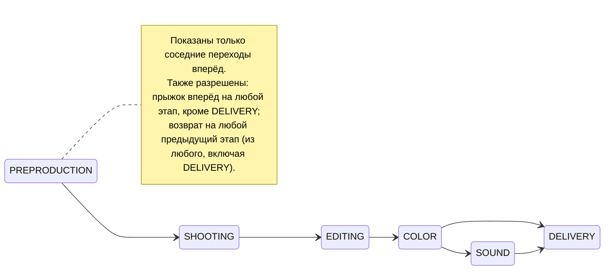
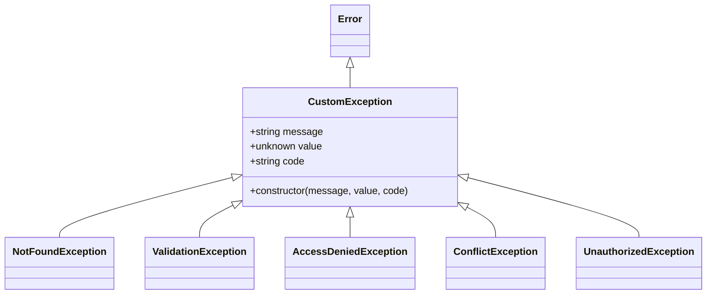
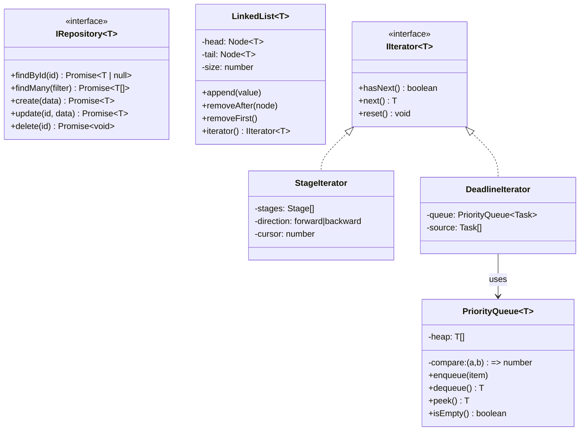

# Data Model: Авторизация, проекты и канбан-доска

**Feature**: 001-auth-projects-kanban · **Date**: 2026-11-23

Документ состоит из двух частей:

1. **Хранимая модель.** Сущности и поля, которые затем лягут в `backend/prisma/schema.prisma`.
2. **Доменная модель ООП-ядра.** Классы из `backend/src/core` и их связи (UML для отчёта,
   принцип VII).

---

## 1. Хранимая модель

### Перечисления

| Enum | Значения |
|---|---|
| `Role` | `PRODUCER`, `EDITOR`, `COLORIST`, `CLIENT` |
| `Stage` | `PREPRODUCTION`, `SHOOTING`, `EDITING`, `COLOR`, `SOUND`, `DELIVERY` (порядок значим) |
| `TaskType` | `SHOOTING`, `EDITING`, `COLOR`, `SOUND`, `GRAPHICS`, `OTHER` |
| `Priority` | `LOW`, `MEDIUM`, `HIGH`, `CRITICAL` |

Доска не хранится отдельной таблицей: у каждого проекта ровно одна доска с
фиксированными колонками (FR-012). Поэтому доска — это задачи проекта, сгруппированные по
`stage`.

### User

| Поле | Тип | Правила |
|---|---|---|
| id | uuid | PK |
| name | string(1..100) | обязательно |
| email | string | уникально, хранится в нижнем регистре, формат email (FR-002) |
| passwordHash | string | argon2id, никогда не отдаётся в API (FR-003) |
| createdAt | datetime | |

### RefreshSession

| Поле | Тип | Правила |
|---|---|---|
| id | uuid | PK |
| userId | uuid → User | при удалении пользователя удаляется вместе с ним |
| tokenHash | string | хеш refresh-токена |
| expiresAt | datetime | +7 дней |
| revokedAt | datetime? | заполняется при выходе или ротации токена |

### Project

| Поле | Тип | Правила |
|---|---|---|
| id | uuid | PK |
| title | string(1..200) | обязательно (FR-006) |
| description | text? | |
| dueDate | date? | дата сдачи |
| createdAt, updatedAt | datetime | |

### ProjectMember

| Поле | Тип | Правила |
|---|---|---|
| projectId | uuid → Project | составной PK вместе с userId |
| userId | uuid → User | |
| role | Role | ровно одна роль (FR-009) |
| joinedAt | datetime | |

**Инварианты:**
- в проекте MUST быть ≥ 1 участник с ролью `PRODUCER` (FR-010). Проверяется в
  `ProjectsService` внутри транзакции;
- пара (projectId, userId) уникальна. Повторное добавление вызывает
  `ValidationException` с кодом `MEMBER_ALREADY_EXISTS`.

### Task

| Поле | Тип | Правила |
|---|---|---|
| id | uuid | PK |
| projectId | uuid → Project | при удалении проекта удаляется вместе с ним |
| title | string(1..200) | обязательно (FR-013) |
| description | text? | |
| type | TaskType | обязательно |
| stage | Stage | обязательно, меняется только через State (FR-017) |
| rank | string | ключ дробной индексации, задаёт порядок внутри колонки |
| priority | Priority | по умолчанию `MEDIUM` |
| assigneeId | uuid? → User | должен быть участником проекта (FR-014). При удалении участника из проекта сбрасывается в null |
| deadline | datetime? | разрешён позже `Project.dueDate`, но API возвращает предупреждение |
| authorId | uuid → User | |
| version | int | начальное значение 0. Растёт при каждом изменении, используется для оптимистической блокировки |
| createdAt, updatedAt | datetime | |

**Индексы:** `(projectId, stage, rank)` для загрузки доски, `(projectId, deadline)` для
списка просроченных задач.

**Производное поле:** `isOverdue = deadline < now() && stage != DELIVERY` (FR-015). Не
хранится в БД, вычисляется при выдаче.

### Диаграмма сущностей

### Переходы между этапами (FR-017, вариант B)

| Из \ В | PRE | SHOOT | EDIT | COLOR | SOUND | DELIV |
|---|---|---|---|---|---|---|
| **PREPRODUCTION** | — | ✓ | ✓ | ✓ | ✓ | ✗ |
| **SHOOTING** | ✓ | — | ✓ | ✓ | ✓ | ✗ |
| **EDITING** | ✓ | ✓ | — | ✓ | ✓ | ✗ |
| **COLOR** | ✓ | ✓ | ✓ | — | ✓ | ✓ |
| **SOUND** | ✓ | ✓ | ✓ | ✓ | — | ✓ |
| **DELIVERY** | ✓ | ✓ | ✓ | ✓ | ✓ | — |

Перемещение внутри той же колонки (меняется только `rank`) разрешено всегда.

---

## 2. Доменная модель ООП-ядра (`backend/src/core`)

### 2.1 Исключения — `core/exceptions`

Глобальный фильтр `common/filters/custom-exception.filter.ts` переводит исключения в HTTP:

| Исключение | HTTP-статус |
|---|---|
| Unauthorized | 401 |
| NotFound | 404 |
| Validation | 400 |
| AccessDenied | 403 |
| Conflict | 409 |
| прочие (в том числе исключения NestJS и Prisma) | 500, а исходная ошибка пишется в `AppLogger` |

Тело ответа: `{ code, message, value }`. Подробнее — в [contracts/rest-api.md](contracts/rest-api.md).

**Коды ошибок этого инкремента:**

| Код | Исключение | Когда |
|---|---|---|
| `AUTH_REQUIRED` | Unauthorized | нет действующей сессии (нет cookie, токен истёк или отозван) |
| `AUTH_INVALID_CREDENTIALS` | AccessDenied | неверный email или пароль |
| `AUTH_EMAIL_TAKEN` | Validation | email уже зарегистрирован |
| `AUTH_WEAK_PASSWORD` | Validation | пароль не прошёл проверку FR-003 |
| `PROJECT_NOT_FOUND` | NotFound | проекта нет |
| `PROJECT_ACCESS_DENIED` | AccessDenied | пользователь не участник проекта |
| `ROLE_FORBIDDEN` | AccessDenied | у роли нет права на действие |
| `USER_NOT_FOUND` | NotFound | нет пользователя с таким email |
| `MEMBER_ALREADY_EXISTS` | Validation | пользователь уже участник |
| `MEMBER_NOT_FOUND` | NotFound | пользователь не участник проекта (смена роли, удаление) |
| `LAST_PRODUCER` | Validation | попытка убрать последнего продюсера |
| `TASK_NOT_FOUND` | NotFound | задачи нет |
| `VALIDATION` | Validation | общая ошибка формата полей; `value` = список полей |
| `TASK_VALIDATION` | Validation | ошибки полей задачи |
| `ASSIGNEE_NOT_MEMBER` | Validation | исполнитель не участник проекта |
| `STAGE_TRANSITION_FORBIDDEN` | Validation | недопустимый переход; `value` = { from, to, allowed[] } |
| `TASK_VERSION_CONFLICT` | Conflict | задачу уже изменил кто-то другой |
| `NOTHING_TO_UNDO` / `NOTHING_TO_REDO` | Validation | история пуста |
| `ITERATOR_EMPTY` / `ITERATOR_EXHAUSTED` | Custom | вызов итератора на пустой коллекции / за её концом |

### 2.2 Коллекции и итераторы — `core/collections`, `core/iterators`

Модули реализуют `IRepository<T>`: `UsersRepository implements IRepository<User>` и т.д.

### 2.3 Паттерны — `core/patterns`

```mermaid
classDiagram
    %% State
    class StageState {
      <<abstract>>
      +stage: Stage
      +allowedTransitions() Stage[]
      +canTransitionTo(target) boolean
    }
    class PreproductionState
    class ShootingState
    class EditingState
    class ColorState
    class SoundState
    class DeliveryState
    class TaskStageContext {
      -state: StageState
      +transitionTo(target: Stage) void
      +current() Stage
    }
    StageState <|-- PreproductionState
    StageState <|-- ShootingState
    StageState <|-- EditingState
    StageState <|-- ColorState
    StageState <|-- SoundState
    StageState <|-- DeliveryState
    TaskStageContext o-- StageState
    StageState ..> StageIterator : uses

    %% Command
    class ICommand {
      <<interface>>
      +execute() Promise~void~
      +undo() Promise~void~
    }
    class MoveTaskCommand {
      -taskId
      -from: Position
      -to: Position
      -versionAfter: number
    }
    class CommandHistory {
      -commands: LinkedList~ICommand~
      -cursor
      -limit = 50
      +push(cmd)
      +undo()
      +redo()
    }
    ICommand <|.. MoveTaskCommand
    CommandHistory o-- ICommand

    %% Factory Method (core: абстракция; modules/tasks/entities: конкретные создатели)
    class ITaskLike {
      <<interface>>
      +id
      +type: TaskType
      +stage: Stage
      +deadline: Date | null
    }
    class TaskCreator~T extends ITaskLike~ {
      <<abstract>>
      +create(data) T
      #createTask(data)* T
      #defaultStage()* Stage
    }
    class TaskCreatorRegistry~T~ {
      -creators: Map~TaskType, TaskCreator~T~~
      +register(type, creator)
      +get(type) TaskCreator~T~
    }
    TaskCreatorRegistry o-- TaskCreator
    TaskCreator ..> ITaskLike : creates
    class ShootingTaskCreator
    class EditingTaskCreator
    class ColorTaskCreator
    class SoundTaskCreator
    class GraphicsTaskCreator
    class OtherTaskCreator
    TaskCreator <|-- ShootingTaskCreator
    TaskCreator <|-- EditingTaskCreator
    TaskCreator <|-- ColorTaskCreator
    TaskCreator <|-- SoundTaskCreator
    TaskCreator <|-- GraphicsTaskCreator
    TaskCreator <|-- OtherTaskCreator

    %% Observer
    class ISubject~E~ {
      <<interface>>
      +subscribe(o)
      +unsubscribe(o)
      +notify(event: E)
    }
    class IObserver~E~ {
      <<interface>>
      +update(event: E)
    }
    class BoardEventBus
    ISubject~E~ <|.. BoardEventBus
    BoardEventBus o-- IObserver~E~

    %% Singleton
    class AppLogger {
      -instance$: AppLogger
      -constructor()
      +getInstance()$ AppLogger
      +log(msg, ctx)
      +error(msg, ctx)
    }
```

**Где что лежит (принципы I и VIII):**
- в `core/patterns/factory` — только абстрактный `TaskCreator<T>` и `TaskCreatorRegistry<T>`.
  Шаблонный метод `create()` подставляет этап по умолчанию и вызывает фабричный метод
  `createTask()`, а реестр при неизвестном типе бросает `ValidationException`;
- в `modules/tasks/entities` — 6 конкретных создателей (`shooting-task.creator.ts` и
  т.д.) и классы задач, которые они создают. Ядро о них не знает: зависимость
  направлена только из модуля в ядро.

`SocketBoardObserver` и `AuditLogObserver` реализуют `IObserver<BoardEvent>`. Они лежат
в `infrastructure/`, потому что зависят от Socket.IO и логгера.

### 2.4 Доменные классы задач — `modules/tasks/entities`

Абстрактный `Task implements ITaskLike` (поля из хранимой модели + `isOverdue()`) и
наследники `ShootingTask`, `EditingTask`, `ColorTask`, `SoundTask`, `GraphicsTask`,
`OtherTask`. Их создают только конкретные создатели `ShootingTaskCreator` …
`OtherTaskCreator extends TaskCreator<Task>`, которые лежат здесь же, а регистрируются в
`TaskCreatorRegistry` из ядра. Значения этапа по умолчанию:

| Создатель | Этап по умолчанию |
|---|---|
| Shooting | PREPRODUCTION |
| Editing | EDITING |
| Color | COLOR |
| Sound | SOUND |
| Graphics, Other | PREPRODUCTION |

Если пользователь создаёт задачу прямо в колонке, используется этап этой колонки, а не
значение по умолчанию.

### 2.5 События доски (`BoardEvent`)

| type | payload |
|---|---|
| `task.created` | Task |
| `task.updated` | Task |
| `task.moved` | { taskId, stage, rank, version } |
| `task.deleted` | { taskId } |
| `member.added` / `member.updated` | ProjectMember |
| `member.removed` | { userId } |

Каждое событие содержит `projectId`, `actorId`, `occurredAt`. Подробнее — в
[contracts/realtime-events.md](contracts/realtime-events.md).
