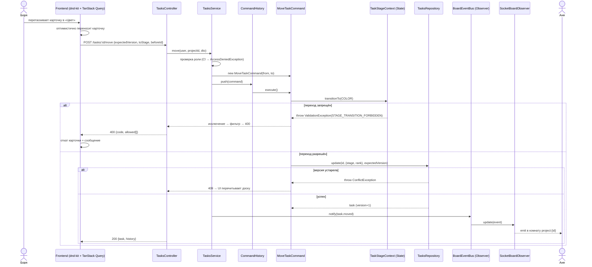

# Implementation Plan: Авторизация, проекты и канбан-доска

**Branch**: `001-auth-projects-kanban` (работа ведётся в `main`) | **Date**: 2026-11-23 | **Spec**: [spec.md](spec.md)

**Input**: Feature specification from `/specs/001-auth-projects-kanban/spec.md`

## Summary

Первый инкремент MVP закладывает каркас монорепо и включает:
- регистрацию и вход;
- проекты с участниками и ролями (продюсер, монтажёр, колорист, заказчик);
- канбан-доску из 6 фиксированных этапов с перетаскиванием карточек;
- правила переходов между этапами (паттерн State);
- личные undo/redo на сервере (паттерн Command поверх `LinkedList<T>`);
- синхронизацию доски через Socket.IO (паттерн Observer), а при обрыве соединения —
  опрос раз в минуту.

Здесь же появляется ООП-ядро: исключения, коллекции, итераторы, а также паттерны State,
Command, Factory Method, Observer и Singleton. Детали решений — в [research.md](research.md).

## Technical Context

**Language/Version**: TypeScript 5.x (strict), Node.js 24 LTS

**Primary Dependencies**:
- бэкенд: NestJS 11, Prisma 6, `@nestjs/websockets` + Socket.IO 4, `@nestjs/jwt`,
  argon2, class-validator, fractional-indexing;
- фронтенд: Next.js 15 (App Router), React 19, Tailwind CSS 4, shadcn/ui, @dnd-kit,
  TanStack Query 5, socket.io-client.

**Storage**: PostgreSQL 16. История undo/redo хранится в памяти процесса бэкенда.

**Testing**:
- Jest: юнит-тесты ядра и интеграционные тесты модулей через Supertest;
- Vitest + Testing Library: фронтенд;
- Playwright: сквозные сценарии.

**Target Platform**: Linux-контейнеры (arm64/amd64) через Docker Compose. Клиент —
настольный браузер.

**Project Type**: веб-приложение (монорепо: `backend` + `frontend` + `shared`)

**Performance Goals**:
- изменение доходит до других участников меньше чем за 2 с (p95);
- подтверждение перемещения карточки — меньше чем за 1 с (p95);
- доска с 200 задачами открывается меньше чем за 2 с.

**Constraints**:
- доска обновляется не реже раза в минуту, даже без живого соединения;
- история undo/redo — 50 шагов на пользователя и доску;
- один экземпляр бэкенда.

**Scale/Scope**: учебный проект — до ~50 пользователей, до ~20 проектов, до 200 задач на
доску. Примерно 6 экранов: вход, регистрация, список проектов, доска, карточка задачи,
участники.

## Constitution Check

*GATE: Must pass before Phase 0 research. Re-check after Phase 1 design.*

| # | Принцип | Как выполняется | До | После |
|---|---|---|---|---|
| I | Выделенное ООП-ядро | Всё из ООП-части лежит в `backend/src/core`. Socket.IO и логгер-адаптер — в `infrastructure`. Ядро не импортирует NestJS и Prisma. Юнит-тесты ядра запускаются без БД | ✅ | ✅ |
| II | Дженерики | `IRepository<T>` реализуют три репозитория. `LinkedList<T>` хранит историю команд. `PriorityQueue<T>` используется в `DeadlineIterator` для списка просроченных задач | ✅ | ✅ |
| III | Единая модель исключений | Иерархия `CustomException` + глобальный фильтр. Добавлен `ConflictException` (409) — это расширение иерархии, а не отступление от неё (R4) | ✅ | ✅ |
| IV | Освобождение ресурсов | `PrismaService.onModuleDestroy` → `$disconnect`. Gateway закрывает сокеты в `onApplicationShutdown`. Очистка устаревших историй команд останавливается в `onModuleDestroy` | ✅ | ✅ |
| V | Паттерны по назначению | State — этапы; Command — undo/redo; Factory Method — типы задач; Observer — синхронизация доски; Singleton — логгер. Strategy и Proxy относятся к видео (инкременты 2 и 5) и здесь сознательно не появляются | ✅ | ✅ |
| VI | Итераторы | `IIterator<T>` + `StageIterator` (вперёд и назад) + `DeadlineIterator`. Коды `ITERATOR_EMPTY` и `ITERATOR_EXHAUSTED` | ✅ | ✅ |
| VII | Документируемость | UML классов и ER-диаграмма — в [data-model.md](data-model.md). Диаграмма последовательности — ниже. JSDoc на русском — обязательная часть задач в tasks.md | ✅ | ✅ |
| VIII | Структура файлов | Дерево ниже повторяет принцип VIII один в один. Модули имеют стандартный состав | ✅ | ✅ |

**Итог:** нарушений нет, раздел Complexity Tracking не нужен.

### Диаграмма последовательности: перемещение карточки (принцип VII)



Отмена работает по той же цепочке: `POST /board/undo` → `CommandHistory.undo()` →
`MoveTaskCommand.undo()`. При этом проверяется `versionAfter` (FR-020).

## Project Structure

### Documentation (this feature)

```text
specs/001-auth-projects-kanban/
├── spec.md
├── plan.md              # этот файл
├── research.md          # Phase 0
├── data-model.md        # Phase 1: сущности + UML ядра
├── quickstart.md        # Phase 1: сценарии проверки
├── contracts/
│   ├── rest-api.md
│   └── realtime-events.md
├── checklists/requirements.md
└── tasks.md             # Phase 2 (/speckit-tasks)
```

### Source Code (repository root)

Структура строго по принципу VIII. Ниже перечислено только то, что появляется в этом
инкременте.

```text
/
├── docker-compose.yml            # postgres, backend, frontend
├── .env.example
├── package.json                  # workspaces
├── shared/src/
│   ├── enums.ts                  # Role, Stage, TaskType, Priority
│   └── contracts/                # auth.ts, projects.ts, tasks.ts, board-events.ts
├── backend/
│   ├── prisma/                   # schema.prisma, migrations/, seed.ts
│   ├── src/
│   │   ├── core/
│   │   │   ├── exceptions/       # custom, not-found, validation, access-denied, conflict + index.ts
│   │   │   ├── collections/      # repository.interface.ts, linked-list.ts, priority-queue.ts + index.ts
│   │   │   ├── iterators/        # iterator.interface.ts, stage.iterator.ts, deadline.iterator.ts + index.ts
│   │   │   └── patterns/
│   │   │       ├── state/        # stage.state.ts, preproduction.state.ts … delivery.state.ts, task-stage.context.ts
│   │   │       ├── command/      # command.interface.ts, move-task.command.ts, command-history.ts
│   │   │       ├── factory/      # task.creator.ts, shooting-task.creator.ts …, task-creator.registry.ts
│   │   │       ├── observer/     # subject.interface.ts, observer.interface.ts, board-event-bus.ts
│   │   │       └── singleton/    # app.logger.ts
│   │   ├── infrastructure/
│   │   │   ├── prisma/           # prisma.service.ts, prisma.module.ts
│   │   │   ├── realtime/         # board.gateway.ts, socket-board.observer.ts
│   │   │   └── logger/           # nest-logger.adapter.ts, audit-log.observer.ts
│   │   ├── common/
│   │   │   ├── filters/          # custom-exception.filter.ts
│   │   │   ├── guards/           # jwt-auth.guard.ts, project-role.guard.ts
│   │   │   └── decorators/       # current-user.decorator.ts, roles.decorator.ts
│   │   ├── modules/
│   │   │   ├── auth/             # module, controller, service, repository(refresh sessions), dto/, entities/
│   │   │   ├── users/            # module, service, repository, entities/
│   │   │   ├── projects/         # module, controller, service, repository, dto/, entities/ (включая members)
│   │   │   ├── boards/           # module, controller (board, undo, redo), service (история команд)
│   │   │   └── tasks/            # module, controller, service, repository, dto/, entities/ (Task + 6 наследников)
│   │   ├── config/
│   │   ├── app.module.ts
│   │   └── main.ts
│   └── test/                     # e2e
├── frontend/src/
│   ├── app/                      # (auth)/login, (auth)/register, projects/, projects/[id]/board, projects/[id]/members
│   ├── components/
│   │   ├── ui/                   # shadcn
│   │   ├── kanban/               # kanban-board, kanban-column, task-card, task-dialog, connection-banner
│   │   └── projects/             # project-list, member-list, add-member-dialog
│   ├── features/
│   │   ├── auth/                 # use-session, api
│   │   ├── projects/             # use-projects, use-members, api
│   │   └── board/                # use-board, use-move-task, use-undo-redo, use-board-socket
│   └── lib/                      # api-client.ts, socket-client.ts, query-client.ts
└── docs/
    ├── uml/                      # диаграммы из data-model.md
    └── screenshots/001/
```

**Structure Decision**: веб-приложение в монорепо по принципу VIII.
- Модуль `members` не выделен отдельно: участники — часть агрегата «проект», поэтому они
  живут в `modules/projects`.
- `boards` — отдельный модуль. Он не хранит свою таблицу: собирает доску из задач и
  управляет историей команд.

## Complexity Tracking

Нарушений конституции нет.
